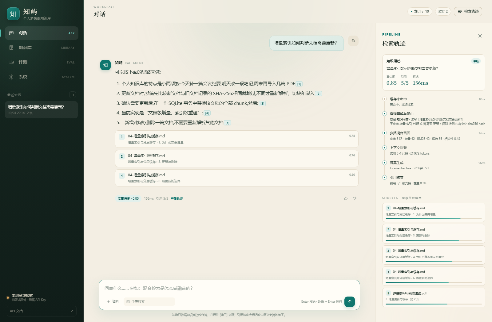
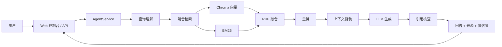

# 知屿 · 个人多模态 RAG 知识库智能体

> 把散落的资料，变成可对话的知识。

「知屿」是一个面向个人知识管理场景的多模态 RAG 问答系统。它支持 PDF、Markdown、图片、文本和 DOCX，围绕**离线索引、混合检索、引用核查、效果评测、增量更新与分层缓存**做了完整工程实现。

> 本仓库是 **Web 版开源版本**，不包含微信小程序客户端及其网关代码；适合本地部署、二次开发和 RAG 工程学习。



## 目录

- [功能](#功能)
- [技术栈](#技术栈)
- [架构](#架构)
- [快速开始](#快速开始)
- [配置](#配置)
- [API](#api)
- [评测](#评测)
- [项目结构](#项目结构)
- [测试](#测试)
- [部署注意](#部署注意)
- [许可与第三方素材](#许可与第三方素材)

## 功能

### 1. 多模态索引

- **PDF**：PyMuPDF 提取文本、字号标题、表格和嵌入图片；文本过少的页面渲染为 PNG 后走 OCR/VLM；pypdf 作为降级解析器。
- **Markdown**：标题栈、代码块、表格、本地图片引用分别处理，chunk 保留完整 `heading_path`。
- **图片**：RapidOCR（可选）→ Tesseract（可选）→ VLM → sidecar 说明文件 → 文件名兜底。
- **DOCX**：标准库解包 `word/document.xml`，保留标题、表格和图片。
- **切块**：先按 section 聚合，再用 LangChain `RecursiveCharacterTextSplitter` 递归切分；默认 720 字符、120 字符重叠。
- **元数据**：文档 id、文件名、页码、标题路径、内容类型、token 估算全部落到 chunk。
- **双索引**：同一批 chunk 同时写入 Chroma（cosine）和 BM25（jieba + 中文 bigram）。

### 2. 检索与 Agent 链路

- **查询理解**：多轮指代消解、意图路由、关键词子查询和离线同义词扩展。
- **多路召回**：向量检索 + BM25，使用 RRF 融合，`k=60`，向量权重 `1.0`，BM25 权重 `0.85`。
- **重排**：在线模型逐片段打分，与启发式先验按 `0.78/0.22` 融合；离线模式使用启发式重排。
- **上下文拼装**：3200 token 预算、相邻 chunk 补全、同文档/同标题去重与配额。
- **引用核查**：逐句提取 `[n]`，计算与所引 chunk 的词元覆盖率和原文命中，输出 coverage / accuracy / unsupported。
- **低置信度二次检索**：检索相关性 `<0.20` 或检索置信度 `<0.34` 时触发 HyDE；生成后综合置信度 `<0.46` 再执行一次受控重试。
- **SSE 流式**：`meta → trace → token… → sources → done`，失败返回 `error`。

### 3. 增量索引与缓存

- 文档用 `source_key` 标识，内容变化用 SHA-256 判断；Hash 相同直接跳过。
- 更新在单个 SQLite 事务里替换该文档全部 chunk，提升全局 `index_version`，再同步向量、BM25 和语义缓存。
- 启动自检：BM25 版本 / embedding 签名 / 向量数量，任一不一致自动修复。
- 三层缓存：进程内 embedding 缓存 → SQLite 精确缓存 → 向量语义缓存（阈值 `0.94`）。
- `index_version` 是所有缓存 key 的命名空间，避免“文档已更新但答案还是旧的”。

### 4. 评测

- JSONL 数据集，标注 `question / ground_truth / relevant_sources[{doc_name, evidence}]`。
- 检索指标：Hit@5、MRR@5、nDCG@5、Context Precision、Context Recall。
- 生成指标：Faithfulness、Answer Relevancy、Token F1、Citation Coverage/Accuracy、p50/p95 延迟。
- 评测器先从全量 chunk 解析相关证据，再与检索结果比较，不拿模型自己的引用当标准答案。
- 后台线程执行，SQLite 持久化，可通过 API 轮询。

## 技术栈

| 层级 | 技术 |
| --- | --- |
| 后端 | Python 3.11+、FastAPI、Uvicorn、Pydantic v2、pydantic-settings |
| 前端 | 原生 HTML / CSS / JavaScript，零构建、无 CDN 依赖 |
| 文本 LLM | DeepSeek / 任意 OpenAI-compatible `/chat/completions` |
| 视觉模型 | OpenAI-compatible VLM（Qwen-VL 等） |
| Embedding | 本地 `hash-1024` 默认；在线 OpenAI-compatible embedding |
| 向量库 | Chroma；失败回退 SQLite + NumPy |
| 稀疏检索 | rank-bm25 + jieba + 中文 bigram |
| 文档解析 | PyMuPDF、pypdf、Pillow、标准库 DOCX XML |
| OCR | RapidOCR（可选）/ Tesseract（可选） |
| 存储 | SQLite WAL、Chroma、BM25 快照 |
| 评测 | 自研 RAGAS 风格指标 |
| 测试 | pytest |

> 实现说明：LangChain 仅用于文本切分，Agent 编排是自研 `AgentService`，没有使用 LangGraph；RAGAS 是风格实现，不是官方 `ragas` 包封装。

## 架构



核心模块：

- `app/agent/orchestrator.py`：会话、缓存、路由、检索、生成、核查、二次检索。
- `app/retrieval/hybrid.py`：向量 + BM25 + RRF。
- `app/retrieval/reranker.py`：LLM / 启发式重排。
- `app/retrieval/context.py`：预算、去重、邻居补全。
- `app/retrieval/verifier.py`：引用核查与置信度。
- `app/indexing/manager.py`：增量索引、修复、删除。
- `app/ingest/`：PDF/Markdown/图片/DOCX 解析、OCR/VLM、切块。
- `app/storage/`：SQLite、Chroma / 本地向量库、BM25。
- `app/eval/`：指标与评测 runner。
- `app/web/`：Web 控制台。

## 快速开始

环境：Python 3.11+，Windows / macOS / Linux。

```bash
git clone https://github.com/Rudeus-GllT/zhiyu-rag.git
cd zhiyu-rag
python -m venv .venv
# Windows
.venv\Scripts\Activate.ps1
# macOS / Linux
# source .venv/bin/activate

pip install -r requirements.txt
copy .env.example .env   # Windows
# cp .env.example .env   # macOS / Linux
python run.py
```

打开：

- Web 控制台：<http://127.0.0.1:8765>
- OpenAPI：<http://127.0.0.1:8765/docs>
- 健康检查：<http://127.0.0.1:8765/health>

首次启动会把 `samples/` 下的示例资料写入知识库；`AUTO_SEED=true` 时只导入一次。

### 离线模式

默认无需 API Key：

```ini
LLM_PROVIDER=mock
EMBEDDING_PROVIDER=hash
EMBEDDING_DIM=1024
VECTOR_BACKEND=auto
```

可以完整跑通解析、索引、检索、引用、缓存和评测，但回答由本地抽取式逻辑生成。

### 在线模型

DeepSeek 文本 + 通义百炼 Embedding/VLM 的示例：

```ini
# 文本：DeepSeek
LLM_PROVIDER=openai
LLM_API_KEY=sk-deepseek...
LLM_BASE_URL=https://api.deepseek.com/v1
LLM_MODEL=deepseek-chat

# Embedding：通义百炼
EMBEDDING_PROVIDER=openai
EMBEDDING_API_KEY=sk-bailian...
EMBEDDING_BASE_URL=https://dashscope.aliyuncs.com/compatible-mode/v1
EMBEDDING_MODEL=qwen3.7-text-embedding
EMBEDDING_DIM=1024
EMBEDDING_BATCH_SIZE=10

# 视觉（可选）
LLM_VISION_MODEL=qwen3-vl-plus
LLM_VISION_BASE_URL=https://dashscope.aliyuncs.com/compatible-mode/v1
LLM_VISION_API_KEY=sk-bailian...
ENABLE_VLM=true
```

视觉模型需要百炼 Key 有对应模型权限；未授权时会回退 OCR/sidecar。

## 配置

所有配置都有默认值，复制 `.env.example` 为 `.env` 后按需修改。

| 变量 | 默认值 | 说明 |
| --- | --- | --- |
| `LLM_PROVIDER` | `auto` | `auto` / `openai` / `mock` |
| `LLM_BASE_URL` | `https://api.deepseek.com/v1` | OpenAI-compatible 端点 |
| `LLM_MODEL` | `deepseek-chat` | 文本生成模型 |
| `LLM_VISION_MODEL` | 空 | 视觉模型；为空则关闭 VLM |
| `LLM_VISION_BASE_URL` | 空 | 视觉模型独立端点 |
| `LLM_VISION_API_KEY` | 空 | 视觉模型独立 Key |
| `EMBEDDING_PROVIDER` | `auto` | `auto` / `hash` / `openai` |
| `EMBEDDING_MODEL` | `BAAI/bge-m3` | 在线 embedding 模型 |
| `EMBEDDING_DIM` | `1024` | hash 维度；在线模型会按返回值修正 |
| `EMBEDDING_BATCH_SIZE` | `10` | 百炼 `text-embedding-v3/v4` 单次最多 10 条 |
| `VECTOR_BACKEND` | `auto` | `auto` / `chroma` / `local` |
| `CHUNK_SIZE` / `CHUNK_OVERLAP` | `720` / `120` | 切块参数 |
| `DENSE_TOP_K` / `BM25_TOP_K` | `14` / `14` | 每路召回数量 |
| `RERANK_TOP_N` | `6` | 进入上下文的候选数 |
| `CONTEXT_TOKEN_BUDGET` | `3200` | 上下文预算 |
| `MIN_CONFIDENCE` | `0.46` | 生成后二次检索阈值 |
| `MIN_RELEVANCE` | `0.20` | 无相关内容拒答阈值 |
| `CACHE_ENABLED` | `true` | 精确/语义缓存总开关 |
| `ENABLE_VLM` | `true` | VLM 开关 |
| `OCR_ENABLED` | `true` | OCR 开关 |
| `DASHBOARD_TOKEN` | 空 | Web API Token；空则本机开放 |

## API

| 方法 | 路径 | 说明 |
| --- | --- | --- |
| `POST` | `/api/v1/chat` | 同步问答 |
| `POST` | `/api/v1/chat/stream` | SSE 流式问答 |
| `GET` | `/api/v1/chat/sessions` | 会话列表 |
| `GET` | `/api/v1/chat/sessions/{id}` | 会话消息 |
| `POST` | `/api/v1/chat/feedback` | 回答反馈 |
| `POST` | `/api/v1/documents/upload` | 多文件上传 |
| `GET` | `/api/v1/documents` | 文档列表 |
| `GET` | `/api/v1/documents/{id}` | 文档详情 |
| `GET` | `/api/v1/documents/{id}/chunks` | chunk 预览 |
| `POST` | `/api/v1/documents/{id}/reindex` | 重建文档索引 |
| `DELETE` | `/api/v1/documents/{id}` | 删除文档 |
| `GET` | `/api/v1/eval/datasets` | 评测数据集 |
| `POST` | `/api/v1/eval/runs` | 启动评测 |
| `GET` | `/api/v1/eval/runs/{id}` | 评测结果 |
| `GET` | `/api/v1/system/info` | 系统状态 |
| `POST` | `/api/v1/system/cache/clear` | 清空缓存 |
| `POST` | `/api/v1/system/index/repair` | 修复向量索引 |

完整 OpenAPI 以 `/docs` 为准。

### SSE 事件

```text
event: meta      data: {"session_id":"...", "intent":"kb_question", ...}
event: trace     data: {"name":"retrieve", "status":"ok", ...}
event: token     data: {"text":"..."}
event: sources   data: {"sources":[...], "confidence":0.81, ...}
event: done      data: {"message_id":"...", ...}
event: error     data: {"message":"..."}
```

## 评测

```bash
python scripts/run_eval_cli.py
```

或启动服务后：

```bash
curl -X POST http://127.0.0.1:8765/api/v1/eval/runs \
  -H "Content-Type: application/json" \
  -d '{"dataset":"golden","limit":11}'
```

离线基线（示例集，仅用于验证评测链路）：

| 指标 | 结果 |
| --- | --- |
| Hit@5 | 1.00 |
| MRR@5 | 0.81 |
| nDCG@5 | 0.81 |
| Faithfulness | 0.99 |
| p95 延迟 | ~72 ms |

> 示例集很小且经过人工标注，不代表开放域效果；接入真实 embedding / LLM 后请用同一套评测重跑。

## 项目结构

```text
zhiyu-rag/
├─ app/
│  ├─ agent/              # AgentService、工具
│  ├─ api/                # FastAPI 路由
│  ├─ core/               # 类型、缓存、工具函数、错误
│  ├─ eval/               # 指标与评测 runner
│  ├─ indexing/           # 增量索引管理
│  ├─ ingest/             # PDF/MD/图片/DOCX、OCR/VLM、切块
│  ├─ llm/                # LLM/embedding/视觉/prompt/启发式降级
│  ├─ retrieval/          # 混合召回、重排、上下文、引用核查
│  ├─ storage/            # SQLite、Chroma/本地向量、BM25
│  └─ web/                # 原生 Web 控制台
├─ samples/               # 示例资料与评测集
├─ scripts/               # 启动、评测、演示脚本
├─ tests/                 # pytest
├─ docs/                  # 架构与第三方素材说明
├─ run.py
├─ requirements.txt
└─ .env.example
```

## 测试

```bash
python -m pytest -q
```

当前测试覆盖：

- 切块保留 heading path
- RRF 与检索指标
- 查询启发式
- 引用核查
- 增量索引与缓存
- 混合文本/视觉端点
- VLM JSON 模式回退

## 部署注意

- **BM25 在进程内**：多实例部署时每个进程需要独立构建，或外置 BM25/检索服务；单机建议一个 Uvicorn worker。
- **Chroma 持久化**：`data/chroma` 需要持久卷；迁移时连同 SQLite 一起备份。
- **embedding 变更**：模型或维度变化会改变签名，启动时自动修复向量并递增 `index_version`，语义缓存会失效。
- **鉴权**：对外部署必须设置 `DASHBOARD_TOKEN`，配置 CORS 白名单和 HTTPS。
- **SSE**：反向代理需要关闭响应缓冲，并适当提高超时。
- **隐私**：不要提交 `.env`、`data/`、上传资料和日志；本仓库 `.gitignore` 已默认排除。

## 许可与第三方素材

- 本项目原创代码使用 **MIT License**，见 [LICENSE](LICENSE)。
- Web 主题中的部分背景、女仆立绘和 logo 来自第三方 DSH 插件，遵循其非商业素材许可；详见 [docs/THIRD_PARTY_NOTICES.md](docs/THIRD_PARTY_NOTICES.md)。
- 若不打算使用这些第三方主题素材，可删除 `app/web/assets/maid-atelier/`、`app/web/assets/big-fish-logo.png`，并把「大肥鱼」主题回退为纯 CSS 色板。
