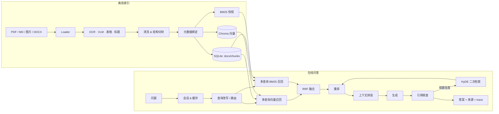

# 架构与实现细节

## 1. 总览

## 2. 数据模型

SQLite 是唯一事实来源，表结构在 `app/storage/db.py`：

| 表 | 作用 |
| --- | --- |
| `documents` | 文档身份、`source_key`、SHA-256、状态、页数、chunk 数、解析元数据 |
| `chunks` | chunk 文本、页码、标题路径、内容类型、token 估算、doc_name |
| `sessions` / `messages` | 多轮会话、答案、引用、trace、置信度、延迟 |
| `feedback` | 点赞 / 点踩 |
| `eval_runs` | 评测状态、进度、配置、指标、逐题结果 |
| `cache_entries` | 精确问答缓存（带 TTL） |
| `semantic_cache` | 问题 embedding + 答案，按索引版本过滤 |
| `embedding_cache` | 文本 Hash → 向量，避免重复嵌入 |
| `kv` | `index_version`、`seeded`、embedding 签名 |

Chunk 的 `id` 由 `doc_id + ordinal + text hash` 稳定生成。文档更新时整篇替换 chunk，保证不会出现新旧片段混排。

## 3. 离线索引

### 3.1 解析

- `app/ingest/loaders.py` 按后缀分派；每个 loader 返回 `ParsedDocument(blocks)`。
- PDF 使用 PyMuPDF 的 `get_text("dict")` 推断标题字号，`find_tables()` 提取表格，嵌入图片过滤小图后交给 Vision。
- 文本长度 < 40 的 PDF 页面视为扫描页，渲染为 PNG 后 OCR/VLM。
- Markdown 维护标题栈，代码块与表格独立成块，本地图片解析后把描述写回 block。
- Vision 的回退顺序：RapidOCR → Tesseract → VLM → sidecar → 文件名。

### 3.2 切块

`app/ingest/chunker.py`：

1. 按 `(heading_path, content_type)` 聚合成 section；图片、代码、表格独立 section。
2. 用 LangChain `RecursiveCharacterTextSplitter` 以中文标点为分隔符递归切分。
3. 每个 chunk 记录 `page_start/page_end`、`heading_path`、`content_type`、`token_estimate`。
4. 单段短文档不会被最小长度过滤，避免“短笔记无法索引”。

### 3.3 双索引

- `IndexManager.ingest_path` 计算 SHA-256，未变化则直接返回 `unchanged`。
- 向量 embedding 的输入是 `heading + text`，BM25 输入同理；chunk 正文本身不重复标题。
- 写入顺序：SQLite 事务保存文档与 chunk → 提升 `index_version` → 删除旧向量并写入新向量 → 重建 BM25 快照。
- 向量写入失败不会丢文档：BM25 仍可检索，`/api/v1/system/index/repair` 可重建。

## 4. 在线链路

### 4.1 查询分析

`LLMService.analyze_query` 优先使用模型 JSON 输出；失败或离线时退回 `heuristics.plan_query`。

- 意图：`kb_question / chitchat / meta / summarize / compare`
- 改写：消解“它 / 这个 / 上述”，把上一轮主题替换进当前问题。
- 子查询：关键词查询 + 领域同义词扩展（如“更新 → 内容变化 / SHA-256”）。
- 路由：寒暄直接回答；meta 走文档统计工具；其余进入检索。

### 4.2 混合召回

`HybridRetriever.retrieve`：

1. 对每个查询分别取 `dense_top_k` 和 `bm25_top_k`。
2. 所有排名列表做 RRF：`score(d) = Σ w_i / (k + rank_i(d))`。
3. 取前 `max(top_k*4, 32)` 个候选，批量从 SQLite 读取 chunk。
4. 如果指定了 `doc_ids`，向量检索下推过滤，BM25 结果后置过滤。

### 4.3 重排与上下文

- `Reranker` 调 `LLMService.rerank`：模型打分与启发式先验融合。
- 启发式考虑：向量分、BM25 分、关键词覆盖、标题命中、内容类型、长度、问句/路由示例惩罚。
- `ContextBuilder`：
  - 对前 2 个候选补全相邻 chunk（0.72 折扣分）。
  - 去除重复文本、同一标题最多 3 个、同一文档最多 4 个。
  - 3200 token 预算，`[n]` 编号与 sources 严格一致。

### 4.4 引用核查与置信度

`CitationVerifier`：

- 正则提取 `[n]`，按句切分，跳过标题/JSON/表格分隔等噪声。
- 句子的 jieba 词元覆盖率；短句（≤7 个词）要求 0.5，长句要求 0.3。
- 引号内原文子串命中可直接判定支持。
- coverage = 有引用句子 / 有效句子；accuracy = 被支持引用 / 总引用。
- 置信度融合 top rerank、检索置信度、引用 accuracy/coverage、来源数量；无引用会乘 0.64 降权。

### 4.5 低置信度二次检索

- 检索相关性 < 0.20 或检索置信度 < 0.34：HyDE 生成假设答案，扩大 top_k，合并候选后重排。
- 生成后综合置信度 < 0.46：同步接口再执行一次完整二次检索与生成；只有第二次置信度高出 0.02 才采用。
- 流式接口只做生成前扩展，避免同一答案重复输出。

## 5. 缓存

| 层 | 位置 | Key | 失效 |
| --- | --- | --- | --- |
| L1 | 进程内 | embedding 文本 Hash | LRU |
| L2 | SQLite | 归一化问题 + top_k + doc_ids + index_version | TTL / 版本变化 |
| L3 | SQLite + 向量 | 问题 embedding 余弦 ≥ 0.94 | 版本过滤 + 定期裁剪 |

只有置信度 ≥ 0.4 的回答写入语义缓存；缓存命中仍会写入新的 assistant 消息，保证会话历史完整。

## 6. 失败与修复

- 解析失败：新文档状态 `error`，不阻塞其他文档；旧文档更新失败时保留旧索引。
- BM25 空库：安全重置，不调用 `BM25Okapi([])`。
- 启动自检：BM25 缓存版本、embedding 签名、向量数量；不一致时执行 `repair_vectors`。
- 向量后端不可用：`VECTOR_BACKEND=auto` 自动回退本地 SQLite+NumPy。

## 7. 扩展点

- 新文件格式：实现 loader 并在 `load_document` 分派。
- 新向量库：实现 `BaseVectorStore` 的 add/delete/search/count/reset。
- 新模型：实现 `BaseLLM.chat/stream`，或在 `create_llm` 增加 provider。
- 新 embedding：实现 `BaseEmbedder.embed`，签名变化会自动触发向量修复。
- 接入官方 RAGAS：替换 `app/eval/runner.py` 中的生成指标计算，保持 `metrics` 结构不变。
