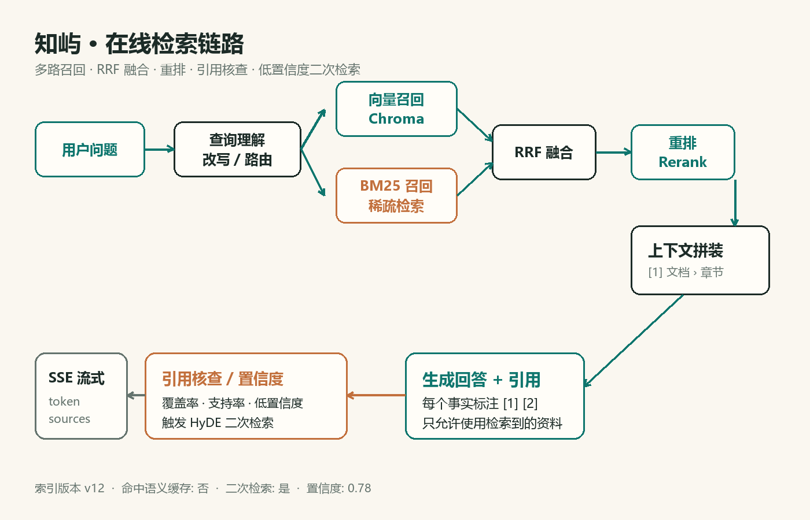

# 多模态文档解析手册

## 1. 为什么解析决定上限

RAG 的效果上限很大程度上由解析质量决定。如果 PDF 的标题、表格和图片说明没有被正确提取，后面的 embedding 和 rerank 再强也无法补回来。因此解析阶段的目标不是“把文件读成字符串”，而是尽量保留文档的结构和语义。

## 2. PDF 解析

PDF 使用 PyMuPDF 逐页处理：

- 先读取页面文本块，并根据字号推断标题层级。明显大于正文的短行会被当作标题，写入 heading_path。
- 使用 `find_tables()` 提取表格，转换成 `列1 | 列2` 的文本块，避免表格内容被拆散。
- 对文本长度少于 40 字的页面，判断为扫描页或图片页，按 2 倍分辨率渲染成 PNG，再交给 OCR 或 VLM。
- 对页面中的嵌入图片，过滤掉小于 80×80 的装饰图，保留有信息量的图片并提取描述。
- 页眉、页脚和孤立页码在清洗阶段删除，减少噪声召回。

如果 PyMuPDF 不可用，系统会回退到 pypdf 的纯文本解析，并明确记录“无 OCR、无图片”的降级警告。

## 3. Markdown 解析

Markdown 按行扫描，保留结构信息：

1. 识别 `#` 到 `######` 标题，维护标题栈，chunk 的 heading_path 就是当前标题路径。
2. 代码围栏整体保留，content_type 标记为 code，避免被递归切分破坏。
3. 连续的 `|` 表格行合并为 table 块。
4. 本地图片引用 `` 会解析为独立图片块，调用 OCR/VLM 后把描述和图中文字写回 chunk。
5. 远程图片默认跳过，避免在索引阶段引入不可控的网络请求。

这样切出来的 chunk 不仅包含正文，还携带“它属于哪一章、是什么类型”的信息。

## 4. 图片与 OCR/VLM

图片解析有多级回退：

- **RapidOCR**：本地 ONNX 模型，支持中文，适合截图、扫描页和带文字的示意图。
- **Tesseract**：如果本机安装了 tesseract，可作为备选 OCR。
- **VLM**：配置视觉模型后，除了文字，还能生成图片描述和关键词，适合图表、流程图和照片。
- **Sidecar 说明**：如果没有 OCR/VLM，会读取图片同名的 `.txt` 或 `.md` 说明文件，保证资料仍可检索。
- **文件名兜底**：最后才使用文件名作为占位描述。

OCR 负责“看清字”，VLM 负责“看懂图”，两者结合比单独使用更稳。示例图片“检索链路示意图”就是通过图片引用进入知识库的。

## 5. 切块策略

切块先按 section 聚合，再递归切分。默认参数：

| 参数 | 默认值 | 说明 |
| --- | --- | --- |
| chunk_size | 720 | 以字符计，兼顾中文语义密度与召回粒度 |
| chunk_overlap | 120 | 保留跨段上下文，减少边界截断 |
| max_chunk_chars | 1400 | 超长 chunk 的硬上限 |
| min_chunk_chars | 40 | 过滤无意义碎片 |

标题会作为 chunk 的第一行参与 embedding 和 BM25，这样“章节名 + 正文”一起被召回。页码记录 page_start 和 page_end，引用卡片可以直接显示来源页。

## 6. 清洗与失败处理

清洗规则包括：NFKC 归一化、去除零宽字符和控制字符、合并多余空行、删除纯页码行。对解析失败的文件，系统会保留文档记录并标记 error，不会让一篇坏文件阻塞整个索引。已有文档更新失败时，旧索引继续可用，避免“越更新越不可用”。

## 7. 检查清单

- 扫描 PDF 是否触发了 OCR？
- 图片是否有可读的描述或图中文字？
- 标题路径是否合理？
- 表格是否被拆成无意义碎片？
- 是否存在大量只有页眉页脚的 chunk？

这些问题可以在知识库详情页查看 chunk 预览，先修解析，再调检索。
